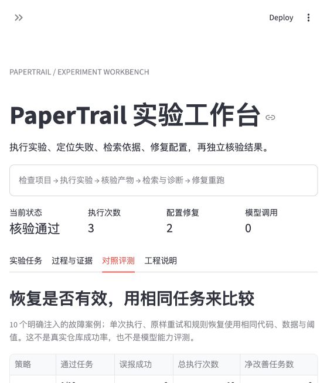
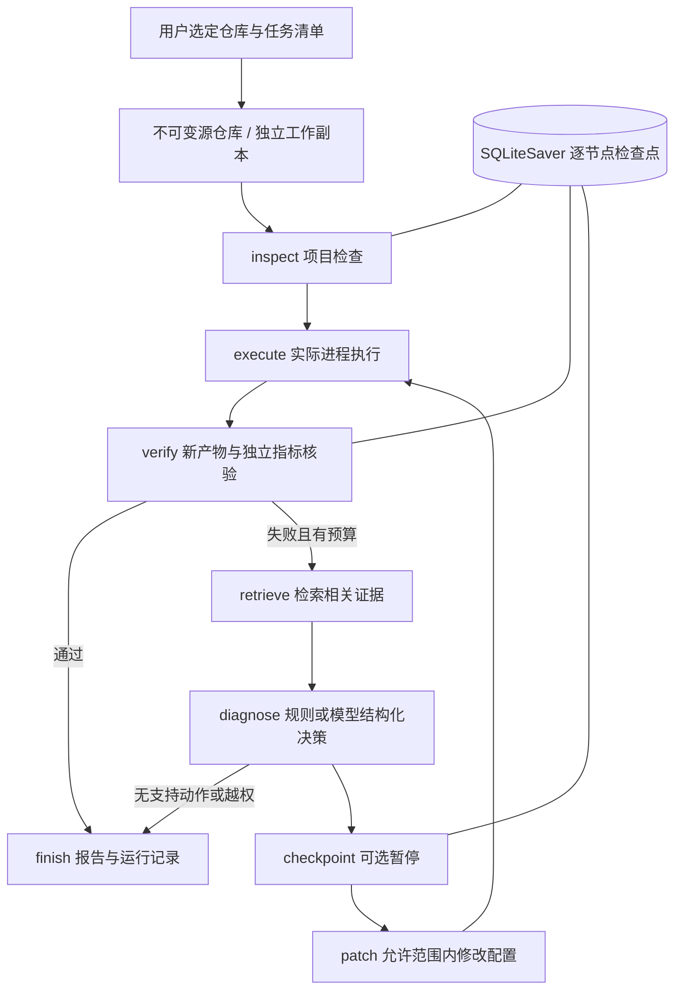

# PaperTrail · NLP 实验执行与恢复 Agent

[English](README.en.md) · [接入自己的项目](docs/adapt-your-project.md) · [贡献指南](CONTRIBUTING.md)

**把实验执行、失败诊断、证据检索、配置修复和独立核验连成一个可追踪的闭环。**

PaperTrail v0.2 面向已有 Python/NLP 仓库。它在独立副本中执行用户选定的实验，读取失败日志，检索项目资料，生成受约束的配置修改，然后重跑并核验预测产物。每个节点保存检查点，可暂停、关闭进程后继续。

它是用于工程学习、演示和评测的项目；没有宣称通用自动修复能力或论文复现创新。



## 三分钟体验

要求 Python 3.11+。建议安装 [uv](https://docs.astral.sh/uv/getting-started/installation/)。

```bash
git clone https://github.com/yk52011/papertrail-agent.git
cd papertrail-agent
uv sync --frozen --python 3.11 --extra dev
uv run streamlit run app.py
```

浏览器打开 `http://127.0.0.1:8501`。默认加载自带的 Sentiment Lab；选择“规则恢复”，点击“启动实验任务”。

也可直接运行：

```bash
uv run papertrail reproduce examples/sentiment-lab --backend local --policy rules
```

这会实际执行三个进程：

1. 第一次：训练数据路径错误，触发 `FileNotFoundError`。
2. 检索相关资料，只修改声明允许的 `train_path`；再次运行发现文本字段错误。
3. 再检索、修改 `text_column`，重新训练 TF-IDF + LogisticRegression，生成预测。
4. 主进程对照执行前载入的参考标签，独立重算 Accuracy、Macro F1，检查样本覆盖与报告一致性。

训练集 48 句、测试集 20 句均为人工构造，仅用于工程演示。缺陷也为明确注入，不能据此推断真实项目成功率。`local` 没有 OS 隔离，只适合可信代码。

## 架构与技术职责



| 技术 | 项目中的实际用途 |
|---|---|
| LangGraph | 条件分支、恢复循环、终止条件和原生动态 interrupt |
| SQLiteSaver | 按任务 ID 持久化图状态，支持跨进程恢复 |
| LangChain | 只读诊断工具调用，以及恢复决策的模型接口与结构化输出 |
| Pydantic | 校验任务清单、预算、实验产物路径、模型恢复决策 |
| RAG | 以当前失败为查询检索项目原文，保留文件、行号、SHA256 |
| BM25 / Embedding / RRF | 离线词法检索；资料诊断支持可选语义检索与排序融合 |
| 子进程 / Docker | 临时副本执行、超时、输出限制；可选禁网容器 |
| 独立评测器 | 检查新指标文件与预测 ID，对固定标签重算指标、识别伪造高分 |
| Streamlit / SQLite | 任务工作台、历史、日志、证据、配置变化及本地任务目录 |
| pytest / GitHub Actions | 恢复、权限、检查点、协议集成测试及固定任务评测 |

## 决策策略

- `none`：只执行一次，不恢复。
- `retry`：同样配置原样重试，用于基线对照。
- `rules`：将已知错误类型映射到任务清单允许的配置候选值。透明的规则演示，不调用 LLM。
- `llm`：向模型发送失败日志、当前配置、允许的候选值和检索证据；通过 LangChain 接收 Pydantic 结构化决策。

模型输出仍须通过服务端校验：只接受 `task.json` 中声明的键和值，引用必须来自当前检索结果，不允许无效引用或无变化修改。系统不让模型修改源代码、命令、标签或核验阈值。

> v0.2 恢复工作流使用 BM25。可选 Embedding + RRF 已在独立的 `ask --semantic` 资料诊断路径实现，尚未接入恢复节点。当前也没有证明 RAG 优于规则恢复。

## 配置模型

复制 `.env.example` 为 `.env`，填写自己的 `OPENAI_API_KEY`、`PAPERTRAIL_MODEL`；兼容服务通过 `OPENAI_BASE_URL` 配置。

```bash
uv run papertrail reproduce examples/sentiment-lab --backend local --policy llm
```

模型需支持工具调用/结构化输出。默认单次模型输出最多 1200 token；恢复流程最多 3 次模型调用，每次请求超时 45 秒，不自动网络重试。任务预算不是精确的费用上限，模型调用或进程清理可能造成时间预算少量超出。

模型模式会发送失败日志、配置和检索资料；Embedding 模式会发送索引片段。文件名过滤不是可靠的密钥检测，请先检查待导入材料。

## 暂停与跨进程继续

```bash
uv run papertrail reproduce examples/sentiment-lab --backend local --step
# 返回 paused 与 job_id；关闭当前进程仍会保留检查点
uv run papertrail jobs
uv run papertrail resume <job_id>
# 连续故障可能在下一次修复前再次暂停；再次 resume 即可
uv run papertrail resume <job_id> --cancel
```

SQLiteSaver 保存每个图节点的状态，原生 `interrupt` 用于修复前暂停；等待期间不消耗活跃运行时间。配置修改使用写前记录和原子替换，降低节点重放带来的重复修改风险。

节点执行采用“至少一次”语义，异常退出后正在执行的实验可能被重放；当前不保证外部操作 exactly-once，也不支持多 worker 同时恢复同一任务。

## 产物核验

每次执行在临时副本中进行，先删除副本内已有的目标指标文件，保留原仓库不变。

核验要求：退出码为 0、未超时、日志未超限、产生新的合法 JSON 指标文件、达到指定阈值。
配置 `ground_truth` 时，还会：

- 在子进程执行前读取固定参考标签并记录 SHA256。
- 要求预测覆盖全部参考 ID，不能遗漏、重复或增加 ID。
- 独立重算 Accuracy 与 Macro F1，拒绝与报告偏差超过 `1e-6` 的指标。
- 输出正确和错误样本 ID。

这证明的是当前任务清单的产物条件；它不验证训练代码科学正确性、训练/测试是否泄漏，也不等同于复现论文。`paper_metric_status` 始终为 `not_verified`。

## 实际评测结果

执行命令：

```bash
uv run python scripts/evaluate_recovery.py
```

当前版本在 10 个**人工故障注入案例**上的实测结果：

| 策略 | 通过任务 | 误报成功 | 总进程执行次数 |
|---|---:|---:|---:|
| 单次执行 | 1 / 10 | 0 | 10 |
| 原样重试，最多 3 次 | 1 / 10 | 0 | 28 |
| 规则恢复，最多 3 次 | 7 / 10 | 0 | 17 |

规则恢复改善 `c02–c07` 六个案例，无损坏案例。无法修复的权限不足、伪造高分和旧产物案例均未误报成功。

该结果使用真实 CPU 子进程，但数据、缺陷和规则均为人工设计。它展示控制流程与核验能力，**不是 LLM 能力、RAG 增益、真实仓库性能或学术创新证据**。

逐案例变化见 [eval/results/recovery.json](eval/results/recovery.json)。原有 12 题检索冒烟评测保留在 `scripts/evaluate.py`。

## Docker 与外部仓库

```bash
# 自行安装 Docker 后构建演示依赖镜像
 docker build -f Dockerfile.nlp -t papertrail-nlp:local .
uv run papertrail reproduce examples/sentiment-lab --policy rules
```

Docker 执行默认禁网、512 MB 内存、1 CPU、64 进程、只读容器根目录，项目副本可写；`container_image` 在实验清单中指定，运行时不自动拉取镜像或安装依赖。

外部项目需要自行准备符合约定的 `task.json`、配置 JSON、实验清单、预测输出与运行依赖。暂不自动克隆仓库或修改任意 Python 代码。当前开发机器没有 Docker，此路径尚未实测。

## 保留的资料诊断功能

```bash
uv run papertrail audit examples/tiny-nlp --output outputs/report.md
uv run papertrail search examples/tiny-nlp "dataset environment Python"
uv run papertrail ask examples/sentiment-lab "先检索原文，再说明运行步骤"
# 可选：设置 PAPERTRAIL_EMBEDDING_MODEL 后启用语义融合检索
uv run papertrail ask examples/sentiment-lab "运行需要什么条件？" --semantic
```

工作台侧边栏可进入“资料检索与诊断”。该路径不执行实验，报告会明确标为尚未运行。

## 开发与目录

```bash
uv run ruff check .
uv run pytest -q
uv run python scripts/evaluate.py
uv run python scripts/evaluate_recovery.py
```

```text
src/papertrail/
  workflow.py       持久化实验执行与恢复状态图
  jobs.py           本地任务目录与结果索引
  runner.py         进程执行、产物与独立指标核验
  agent.py          只读模型工具循环
  retrieval.py      带来源的 BM25 与可选向量融合检索
  audit.py           静态检查、证据报告
  cli.py             命令行入口
app.py / pages/      任务工作台与资料诊断
examples/            两个可离线运行的演示仓库
scripts/ / eval/     检索与恢复评测、逐案例结果
 tests/              单元、流程和本地 HTTP 协议集成测试
```

测试不调用外部模型。真实 LangChain HTTP 请求和解析链路使用本地兼容接口替身验证；真实模型的选择质量仍待评测。界面、恢复闭环和最小训练在本机实际运行。

项目附 MIT 许可证、锁文件及 GitHub Actions 配置。不要提交 `.env`、私人仓库资料或 `.papertrail/` 的本地任务记录。

- [三分钟演示脚本](docs/demo-guide.md)
- [技术边界与简历写法](docs/project-status.md)
- [相关工作与定位](docs/related-work.md)
- [接入自己的 NLP 项目](docs/adapt-your-project.md)
- [工作原理与技术分工](docs/how-it-works.md)
